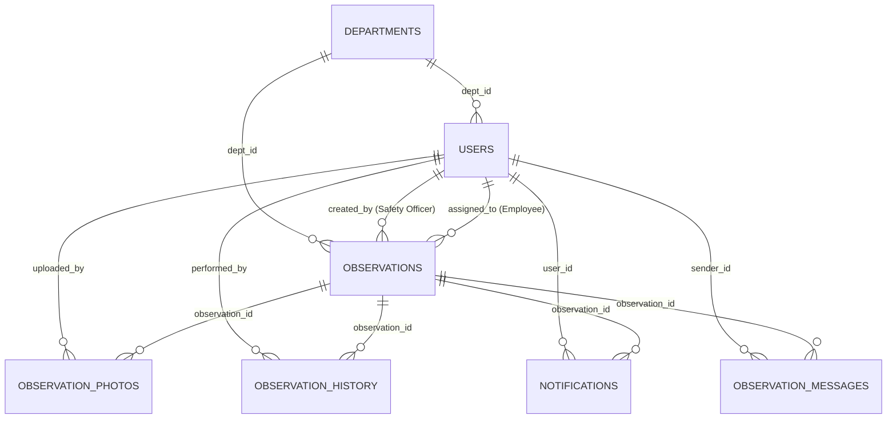

# Health & Safety —  (EHS) Management System

[](https://react.dev/)
[](https://supabase.com/)
[](#ui--ux-design-system)
[](#mobile-responsiveness)
[](#safety-training-records-iso-45001-compliance)

**Health & Safety** is an enterprise-grade **Environment, Health, and Safety (EHS) Management System** tailored for manufacturing facilities, steel processing plants (SK Aispat / Sarthak TMT), construction, and heavy engineering worksites. 

Engineered with **React 19, TypeScript, Vite, Supabase (PostgreSQL), and Vanilla CSS**, the system unifies workplace hazard observations, corrective action tracking, automated ISO risk score calculations, multi-cycle officer reviews, ISO safety training records, verified PDF/CSV audit reports, and real-time employee notifications into a single, high-performance platform.

---

## Table of Contents
1. [Core Architectural Innovation: The Unified Data Model](#core-architectural-innovation-the-unified-data-model)
2. [Technology Stack](#technology-stack)
3. [Project Directory Structure](#project-directory-structure)
4. [Database Schema & Field Mappings](#database-schema--field-mappings)
5. [PostgreSQL Triggers & Stored Functions](#postgresql-triggers--stored-functions)
6. [User Roles & Access Control Matrix](#user-roles--access-control-matrix)
7. [Core Workflows & Features](#core-workflows--features)
   - [Hazard Observation & Task Creation](#1-hazard-observation--task-creation)
   - [Employee Corrective Action Submission](#2-employee-corrective-action-submission)
   - [Officer Review & Multi-Cycle Rework Loop](#3-officer-review--multi-cycle-rework-loop)
   - [Personal Safety Observations](#4-personal-safety-observations)
   - [Safety Training & Drills (ISO 45001)](#5-safety-training--drills-iso-45001)
   - [Exportable Audit Reports (PDF & CSV)](#6-exportable-audit-reports-pdf--csv)
   - [Real-Time Notification Center & Chat](#7-real-time-notification-center--chat)
8. [UI / UX Design System](#ui--ux-design-system)
9. [Mobile Responsiveness](#mobile-responsiveness)
10. [Installation & Local Setup](#installation--local-setup)
11. [Build & Deployment](#build--deployment)

---

## Core Architectural Innovation: The Unified Data Model

### Merging Observation & Work Order into a Single Record
In traditional EHS software, an "Observation" is created in one register, while an actionable "Task" or "Work Order" is managed separately in another. This causes duplicate entries, data divergence, and synchronization lag.

In **Health & Safety**, **Observation and Task are unified into a single database table (`public.observations`)**:
- When an observer logs a workplace safety hazard, they simultaneously select the responsible employee (`assigned_to`) and set a target completion deadline (`due_date`).
- A single record represents both the hazard condition and the corrective work order.
- This provides zero data divergence, instantaneous status updates, and transparent accountability.



---

## Technology Stack

| Layer | Technologies | Purpose |
|---|---|---|
| **Frontend Framework** | **React 19** (`react`, `react-dom` v19.0.0) | High-performance user interface rendering |
| **Language** | **TypeScript 5.7.2** | Strict static typing across models, props, and database schemas |
| **Build Tool & Bundler** | **Vite 8.2.2** | Blazing-fast HMR and optimized production bundles |
| **Routing** | **React Router DOM 7.18.3** | Client-side routing with guarded layouts |
| **Styling** | **Pure Vanilla CSS** (`src/index.css`) | Bespoke industrial light-theme design system; 0 heavy external CSS dependencies |
| **Backend & Database** | **Supabase (PostgreSQL)** | Persistent relational database, triggers, stored procedures, Row Level Security (RLS) |
| **Cloud Storage** | **Supabase Storage** (`observation` bucket) | Inspection evidence photos and corrective action image uploads |
| **Icons** | **Lucide React** (`lucide-react`) | Industrial and semantic iconography |
| **Data Visualization** | **Recharts 3.10.1** | Risk distribution charts, department SLA graphs, and KPI analytics |
| **Export Engines** | **jsPDF 4.2.1** & **html2canvas 1.4.1** | Client-side high-resolution PDF generation with side-by-side Before/After comparisons |
| **Micro-Interactions** | **canvas-confetti 1.9.4** | Visual reward feedback on successful officer approvals |

---

## Project Directory Structure

```text
Health&Safety/
├── public/                     # Static public assets (logos, icons)
│   ├── logo.jpg
│   └── logo2.jpg
├── src/
│   ├── assets/                 # SVGs and branding graphics
│   ├── components/             # Reusable UI component modules
│   │   ├── chat/               # Real-time task chat and mention modal
│   │   │   └── TaskChatModal.tsx
│   │   ├── common/             # Badges, modals, photo uploaders, toasts, galleries
│   │   │   ├── Badge.tsx
│   │   │   ├── Modal.tsx
│   │   │   ├── PhotoGallery.tsx
│   │   │   ├── PhotoUploader.tsx
│   │   │   └── ToastContainer.tsx
│   │   ├── dashboard/          # Stat KPI cards, charts, and activity feeds
│   │   │   ├── ActivityFeed.tsx
│   │   │   ├── ChartSection.tsx
│   │   │   └── StatCard.tsx
│   │   ├── layout/             # Header, sidebar, mobile bottom navigation, notification bell
│   │   │   ├── AppHeader.tsx
│   │   │   ├── AppSidebar.tsx
│   │   │   ├── MobileBottomNav.tsx
│   │   │   └── NotificationDropdown.tsx
│   │   ├── observations/       # Create observation and personal observation modals
│   │   │   ├── CreateObservationModal.tsx
│   │   │   └── PersonalObservationModal.tsx
│   │   ├── tasks/              # Task cards, corrective forms, timelines, inspection review modal
│   │   │   ├── CorrectiveActionForm.tsx
│   │   │   ├── CreateOfficerTaskModal.tsx
│   │   │   ├── OfficerReviewModal.tsx
│   │   │   ├── TaskCard.tsx
│   │   │   ├── TaskDetailModal.tsx
│   │   │   └── TaskTimeline.tsx
│   │   └── training/           # Training creation modal
│   │       └── CreateTrainingModal.tsx
│   ├── context/                # Global React context state
│   │   ├── AuthContext.tsx     # Session management, RBAC resolution, user switcher
│   │   └── ToastContext.tsx    # Global alert/toast notification banner system
│   ├── lib/                    # Supabase client singleton and fallback mock datasets
│   │   ├── mockData.ts
│   │   └── supabase.ts
│   ├── pages/                  # Top-level routable view pages
│   │   ├── auth/               # User login view
│   │   │   └── LoginPage.tsx
│   │   ├── dashboard/          # Metric KPIs, risk charts, and overview
│   │   │   └── DashboardPage.tsx
│   │   ├── notifications/      # Dedicated full-page notification center
│   │   │   └── NotificationsPage.tsx
│   │   ├── observations/       # All observations list, create page, and personal monitoring
│   │   │   ├── AllObservationsPage.tsx
│   │   │   ├── CreateObservationPage.tsx
│   │   │   └── MyObservationsPage.tsx
│   │   ├── reports/            # Compliance reports and CSV export generator
│   │   │   └── ReportsPage.tsx
│   │   ├── tasks/              # Task registers, awaiting review queue, and employee inbox
│   │   │   ├── AllTasksPage.tsx
│   │   │   ├── AwaitingReviewPage.tsx
│   │   │   └── MyTasksPage.tsx
│   │   └── training/           # Training session registers and session logger
│   │       ├── AddTrainingPage.tsx
│   │       └── TrainingRecordsPage.tsx
│   ├── services/
│   │   └── dataService.ts      # Unified data access layer (Supabase + localStorage fallback)
│   ├── types/
│   │   └── database.ts         # TypeScript interfaces, types, and risk mappings
│   ├── utils/                  # Date formatters (IST) and PDF export engine
│   │   ├── dateUtils.ts
│   │   └── reportExport.ts
│   ├── App.tsx                 # Route definitions and application shell layout
│   ├── index.css               # Bespoke Industrial Light Theme CSS design system
│   └── main.tsx                # React application entry point
├── supabase/                   # PostgreSQL schema definitions and database triggers
│   ├── pages_schema.sql        # Core migration with tables, triggers, and RLS policies
│   ├── schema.sql              # Extended schema definition
│   └── seed.sql                # Clean database state instructions
├── index.html                  # HTML entry template
├── package.json                # Project dependencies and script definitions
├── tsconfig.json               # TypeScript configuration
├── vercel.json                 # Single-page app rewrite configuration for Vercel
└── vite.config.ts              # Vite build setup
```

---

## Database Schema & Field Mappings

All backend operations connect directly to PostgreSQL on Supabase via `@supabase/supabase-js`. The schema strictly honors existing primary key conventions (`emp_id` and `dept_id`).

### 1. `public.users`
Stores user credentials, organizational positions, and employee profiles.
- **Primary Key**: `emp_id` (`BIGINT`)
- **Key Columns**:
  - `emp_id`: Unique employee ID used as the foreign key target across all tables.
  - `full_name`: Display name of the employee.
  - `username`: Login username / handle (unique).
  - `password`: Authentication credential.
  - `position`: Job title. If set to `'HEALTH AND SAFETY'`, grants **Safety Officer / Admin** privileges; otherwise sets **Employee** role.
  - `dept_id`: Foreign key referencing `public.departments(dept_id)`.
  - `status`: Account status (`active` / `inactive`).
  - `mobile_number`: Contact phone number.

### 2. `public.departments`
Stores plant units, divisions, and shop-floor operating areas.
- **Primary Key**: `dept_id` (`BIGINT`)
- **Key Columns**:
  - `dept_id`: Unique department identifier.
  - `name` / `dept_name`: Full department name (e.g., *Steel Melting Shop*, *Blast Furnace*, *Rolling Mill*).
  - `code`: Abbreviation code (e.g., `SMS`, `BF-01`, `RM`).
  - `is_active`: Operational status toggle.

### 3. `public.observations` (Unified Core Table)
The single consolidated record storing both hazard observations and actionable corrective work orders.
- **Primary Key**: `id` (`UUID DEFAULT gen_random_uuid()`)
- **Foreign Keys**:
  - `created_by BIGINT REFERENCES public.users(emp_id)`: Officer logging the hazard.
  - `dept_id BIGINT REFERENCES public.departments(dept_id)`: Plant department of the hazard.
  - `assigned_to BIGINT REFERENCES public.users(emp_id)`: Employee assigned to resolve it.
  - `completed_by BIGINT REFERENCES public.users(emp_id)`: Officer who verified resolution.
  - `closed_by BIGINT REFERENCES public.users(emp_id)`: User who signed off closure.
- **Hazard Details**:
  - `area` (`VARCHAR(255)`): Specific plant location, machine bay, or floor.
  - `observation_text` (`TEXT`): Description of the hazard condition.
  - `solution_text` (`TEXT`): Recommended preventive directive.
  - `priority` (`VARCHAR(20)`): `'LOW'`, `'MEDIUM'`, or `'HIGH'`.
  - `risk_min` (`NUMERIC(3,1)`): Minimum risk score percentage (auto-calculated by trigger).
  - `risk_max` (`NUMERIC(3,1)`): Maximum risk score percentage (auto-calculated by trigger).
- **Work Order & Review Tracking**:
  - `due_date` (`TIMESTAMPTZ`): Resolution target deadline.
  - `status` (`VARCHAR(50)`): Current state:
    `OPEN` | `ASSIGNED` | `IN_PROGRESS` | `SUBMITTED_FOR_REVIEW` | `REWORK_REQUIRED` | `COMPLETED` | `OVERDUE` | `CLOSED`
  - `corrective_action` (`TEXT`): Latest resolution description submitted by assignee.
  - `rework_reason` (`TEXT`): Rejection feedback provided by officer when requesting rework.
  - `is_personal` (`BOOLEAN`): If `TRUE`, acts as an independent officer monitoring observation (unassigned to employees).
- **Audit Timestamps**: `created_at`, `updated_at`, `completed_at`, `closed_at`.

### 4. `public.observation_photos`
Stores photographic evidence for both initial hazard inspections and subsequent corrective resolutions.
- **Primary Key**: `id` (`UUID DEFAULT gen_random_uuid()`)
- **Foreign Keys**:
  - `observation_id UUID REFERENCES public.observations(id) ON DELETE CASCADE`
  - `uploaded_by BIGINT REFERENCES public.users(emp_id)`
- **Key Columns**:
  - `photo_url`: Public URL in Supabase Storage or Base64 data URI.
  - `file_name`: Original image filename.
  - `photo_type`:
    - `'INITIAL'`: Captured when the hazard was logged by the safety officer.
    - `'CORRECTIVE'`: Captured by the employee as proof of repair/containment.
  - `created_at`: Timestamp of upload.

### 5. `public.observation_history`
Full audit trial and multi-cycle rework loop tracking engine.
- **Primary Key**: `id` (`UUID DEFAULT gen_random_uuid()`)
- **Foreign Keys**:
  - `observation_id UUID REFERENCES public.observations(id) ON DELETE CASCADE`
  - `performed_by BIGINT REFERENCES public.users(emp_id)`
- **Key Columns**:
  - `action_type`: `'ASSIGNED'`, `'SUBMITTED_FOR_REVIEW'`, `'REWORK_REQUIRED'`, `'COMPLETED'`, `'CLOSED'`.
  - `attempt_number`: Cycle counter (`1`, `2`, `3`, `4`, `5+`).
  - `description`: Text remarks submitted during this attempt.
  - `rework_reason`: Officer refusal justification (if rejected).
  - `previous_status` & `new_status`: Transition tracking.
  - `photos`: JSONB array of photo references submitted in that cycle.
  - `created_at`: Timestamp of the audit event.

### 6. `public.notifications`
In-app notification system alerting users of assignments, review submissions, and overdue tasks.
- **Primary Key**: `id` (`UUID DEFAULT gen_random_uuid()`)
- **Foreign Keys**:
  - `user_id BIGINT REFERENCES public.users(emp_id) ON DELETE CASCADE`
  - `observation_id UUID REFERENCES public.observations(id) ON DELETE CASCADE`
- **Key Columns**:
  - `notification_type`: `'TASK_ASSIGNED'`, `'CORRECTIVE_SUBMITTED'`, `'REWORK_REQUESTED'`, `'TASK_COMPLETED'`, `'TASK_OVERDUE'`, `'CHAT_MESSAGE'`.
  - `title`: Alert title.
  - `message`: Notification content.
  - `is_read`: Boolean read status flag.
  - `created_at`: Notification timestamp.

### 7. `public.observation_messages`
Real-time threaded discussion per observation task.
- **Primary Key**: `id` (`UUID DEFAULT gen_random_uuid()`)
- **Foreign Keys**:
  - `observation_id UUID REFERENCES public.observations(id) ON DELETE CASCADE`
  - `sender_id BIGINT REFERENCES public.users(emp_id)`
- **Key Columns**:
  - `message`: Text message body (supports `@User` mentions).
  - `created_at`: Timestamp of the message.

---

## PostgreSQL Triggers & Stored Functions

Located in [`supabase/pages_schema.sql`](supabase/pages_schema.sql):

### 1. Automatic ISO Risk Calculation Trigger
```sql
CREATE OR REPLACE FUNCTION trg_calculate_observation_risk()
RETURNS TRIGGER AS $$
BEGIN
    IF NEW.priority = 'LOW' THEN    
        NEW.risk_min := 1.0;
        NEW.risk_max := 3.0;
    ELSIF NEW.priority = 'MEDIUM' THEN
        NEW.risk_min := 3.0;
        NEW.risk_max := 6.0;
    ELSIF NEW.priority = 'HIGH' THEN
        NEW.risk_min := 6.0;
        NEW.risk_max := 9.0;
    END IF;
    RETURN NEW;
END;
$$ LANGUAGE plpgsql;

CREATE TRIGGER set_observation_risk
    BEFORE INSERT OR UPDATE OF priority ON public.observations
    FOR EACH ROW
    EXECUTE FUNCTION trg_calculate_observation_risk();
```
- **Why it exists**: Industrial safety standards (ISO 45001) require hazards to be numerically quantified by a probability/severity risk range.
- **What it does**: Ensures risk values are mathematically consistent, whether inserted via the UI, mobile device, or direct SQL script.

### 2. Auto-Update Timestamp Trigger
```sql
CREATE OR REPLACE FUNCTION trg_update_observation_timestamp()
RETURNS TRIGGER AS $$
BEGIN
    NEW.updated_at = NOW();
    RETURN NEW;
END;
$$ LANGUAGE plpgsql;

CREATE TRIGGER update_observations_modtime
    BEFORE UPDATE ON public.observations
    FOR EACH ROW
    EXECUTE FUNCTION trg_update_observation_timestamp();
```
- **What it does**: Guarantees that `updated_at` always reflects the exact timestamp of status updates, employee submissions, or officer approvals.

### 3. Automated Overdue Escalation Function
```sql
CREATE OR REPLACE FUNCTION public.check_and_update_overdue_tasks()
RETURNS INTEGER AS $$
DECLARE
    overdue_count INTEGER := 0;
    r RECORD;
BEGIN
    FOR r IN 
        SELECT o.id, o.created_by, u.full_name as assignee_name
        FROM public.observations o
        JOIN public.users u ON o.assigned_to = u.emp_id
        WHERE o.due_date < NOW()
          AND o.status NOT IN ('COMPLETED', 'CLOSED', 'OVERDUE')
    LOOP
        UPDATE public.observations 
        SET status = 'OVERDUE', updated_at = NOW() 
        WHERE id = r.id;

        INSERT INTO public.notifications (user_id, observation_id, notification_type, title, message)
        VALUES (
            r.created_by,
            r.id,
            'TASK_OVERDUE',
            'Overdue Safety Action',
            'Observation task assigned to ' || r.assignee_name || ' has passed its resolution due date.'
        );

        overdue_count := overdue_count + 1;
    END LOOP;
    RETURN overdue_count;
END;
$$ LANGUAGE plpgsql;
```
- **What it does**: Flags expired unresolved tasks as `OVERDUE` and automatically generates urgent alerts for safety officers. Can be scheduled with `pg_cron` or invoked manually.

---

## User Roles & Access Control Matrix

Role detection is evaluated dynamically in [AuthContext.tsx](src/context/AuthContext.tsx) based on the user's `position` in `public.users`:

| Feature / Action | Health & Safety Officer (`position = 'HEALTH AND SAFETY'`) | Plant Employee / Worker (Any Other Position) |
|---|:---:|:---:|
| **Dashboard View** | Full Plant KPIs, Recharts Analytics, All Pending Audits | Assigned Personal Task Queue & Progress Overview |
| **Log Hazard & Create Observation** | Yes (Selects assignee & target due date) | Read-only |
| **Log Personal Safety Observation** | Yes (Independent officer monitoring) | No |
| **View All Observations & Tasks** | Yes (All plant departments & filters) | Read-only |
| **View Assigned Tasks** | Yes (Can toggle between "Mine" and "All") | Yes ("My Tasks" inbox) |
| **Submit Corrective Action & Photos** | Yes (If self-assigned) | Yes (Primary workflow) |
| **Review & Approve Submissions** | Yes (Signs off completion with celebration) | No |
| **Send Back for Rework (Multi-cycle)** | Yes (Enforces mandatory refusal justification) | No |
| **Log ISO Safety Training Sessions** | Yes (Topics, trainee counts, photo proof) | Read-only |
| **Export PDF Verified Reports** | Yes | Yes (For assigned tasks) |
| **Export Audit CSV Spreadsheets** | Yes (Observations, SLAs, Training) | No |
| **Task Chat & User Mentions** | Yes | Yes |

---

## Core Workflows & Features

### 1. Hazard Observation & Task Creation
Located in [`CreateObservationPage.tsx`](src/pages/observations/CreateObservationPage.tsx) and [`CreateObservationModal.tsx`](src/components/observations/CreateObservationModal.tsx):
1. **Department & Area**: Officer selects the plant department (e.g., Blast Furnace) and enters the specific area/machinery bay.
2. **Priority & Risk**: Selecting `LOW`, `MEDIUM`, or `HIGH` immediately calculates and displays the ISO risk factor range.
3. **Hazard Details**: Officer details the observed condition and provides recommended corrective guidance.
4. **Assignee & Deadline**: Officer selects the responsible employee from the active staff list and sets a resolution due date.
5. **Initial Photos**: Officer attaches up to 10 photos of the hazardous condition.
6. **Execution**: A single atomic transaction writes to `public.observations`, inserts into `public.observation_photos` (`photo_type = 'INITIAL'`), logs the initial event in `public.observation_history`, and delivers a `TASK_ASSIGNED` alert to the employee.

---

### 2. Employee Corrective Action Submission
Located in [`MyTasksPage.tsx`](src/pages/tasks/MyTasksPage.tsx) and [`CorrectiveActionForm.tsx`](src/components/tasks/CorrectiveActionForm.tsx):
1. The employee opens **My Tasks** and selects their assigned work order.
2. The form highlights whether this is an **Initial Attempt (#1)** or a **Rework Cycle (#2, #3...)**.
3. If the task was previously rejected, an amber callout displays the Safety Officer's exact rework instructions.
4. The worker enters their solution remarks and uploads after-repair photographic proof.
5. Worker selects resolution stage:
   - **Submit for Review**: Changes status to `SUBMITTED_FOR_REVIEW` and notifies the safety officer.
   - **Partially Done**: Sets status to `IN_PROGRESS` with audit progress logs.
6. Photos are tagged with `photo_type = 'CORRECTIVE'` and linked to that specific attempt number in `public.observation_history`.

---

### 3. Officer Review & Multi-Cycle Rework Loop
Located in [`AwaitingReviewPage.tsx`](src/pages/tasks/AwaitingReviewPage.tsx) and [`OfficerReviewModal.tsx`](src/components/tasks/OfficerReviewModal.tsx):
The system supports infinite cycle loops (Attempt 1 $\rightarrow$ Rework 1 $\rightarrow$ Attempt 2 $\rightarrow$ Rework 2 $\rightarrow$ Attempt 3...) while preserving a complete audit record of each attempt.

```text
[ HAZARD LOGGED ] ──► [ ASSIGNED ] ──► [ EMPLOYEE ATTEMPT #1 ]
                                                │
                                                ▼
                                    [ SUBMITTED FOR REVIEW ]
                                                │
                          ┌─────────────────────┴─────────────────────┐
                          ▼                                           ▼
                 [ OFFICER APPROVAL ]                        [ OFFICER REJECTION ]
                          │                                           │
                          ▼                                           ▼
                   [ COMPLETED ]                             [ REWORK REQUIRED ]
                 (Verified & Closed;                         (Mandatory feedback attached;
                  Confetti animation;                         Returns to Employee for
                  Audit sign-off)                             Attempt #2, #3...)
```

- **Approve**: Marked `COMPLETED`, records officer completion timestamp, triggers celebratory confetti, and notifies employee.
- **Rework**: Officer enters mandatory explanation of why the action was rejected. Status switches to `REWORK_REQUIRED`, and the employee is alerted with the rework reason.

---

### 4. Personal Safety Observations
Located in [`MyObservationsPage.tsx`](src/pages/observations/MyObservationsPage.tsx) and [`PersonalObservationModal.tsx`](src/components/observations/PersonalObservationModal.tsx):
- Allows Safety Officers to log workplace hazards that they manage personally without assigning tasks to workers.
- Supports a streamlined `OPEN` $\leftrightarrow$ `CLOSED` lifecycle with optional closing notes.

---

### 5. Safety Training & Drills (ISO 45001 Compliance)
Located in [`TrainingRecordsPage.tsx`](src/pages/training/TrainingRecordsPage.tsx) and [`AddTrainingPage.tsx`](src/pages/training/AddTrainingPage.tsx):
- Documents occupational health & safety training, machinery operating drills, and PPE compliance workshops.
- Records department, topic, instructor, number of trainees, and session photographic proof.
- Aggregates total worker attendance metrics for regulatory audits.

---

### 6. Exportable Audit Reports (PDF & CSV)

#### Client-Side PDF Generation (`exportTaskReportPDF`)
Located in [`src/utils/reportExport.ts`](src/utils/reportExport.ts):
- Compiles the entire history of an observation into a high-resolution, print-ready ISO 45001 compliance document.
- **Side-by-Side Comparison**:
  - **LEFT (BEFORE)**: Initial hazard statement with initial inspection photos.
  - **RIGHT (AFTER)**: Complete chronological timeline of all employee attempts, worker remarks, corrective photos, and officer rework feedback.
- Pre-converts images to base64 to ensure instant rendering without CORS latency.
- Automates filename generation based on department, area, and completion date.

#### Verifiable CSV Exports
Located in [`ReportsPage.tsx`](src/pages/reports/ReportsPage.tsx):
- **Observations Audit CSV**: Full register of all hazard locations, priority ratings, risk score percentages, assignees, and dates.
- **Tasks SLA CSV**: Turnaround metrics calculating duration from hazard discovery to final verified closure.
- **Training Records CSV**: Session logs, topic breakdowns, and attendee counts.

---

### 7. Real-Time Notification Center & Chat
- **Top Header Bell (`NotificationDropdown.tsx`)**: Unread badge count, dropdown previews, and 1-click mark-all-read.
- **Dedicated Center (`NotificationsPage.tsx`)**: Filterable history of alerts.
- **Threaded Chat Modal (`TaskChatModal.tsx`)**: Inline communication on tasks with `@User` mention autocomplete.

---

## UI / UX Design System

The application utilizes a custom Vanilla CSS design system ([`src/index.css`](src/index.css)) built specifically for industrial shop-floor clarity:
- **Color Palette**:
  - Industrial Primary: Deep Crimson (`#b91c1c` / `#991b1b`)
  - Secondary Accent: Precision Blue (`#0284c7`)
  - Risk Accents: High Hazard Red (`#dc2626`), Medium Hazard Amber (`#d97706`), Low Hazard Emerald (`#059669`)
  - Clean Light Surfaces: Neutral White (`#ffffff`) and Slate Slate (`#f8fafc`, `#f1f5f9`)
- **Typography**: Inter (system fallback) and JetBrains Mono for task identification numbers.
- **Card System (`.ehs-card`)**: High-contrast border radius, subtle elevations, and color-coded status badges.

---

## Mobile Responsiveness

The interface is optimized for handheld smartphones and tablets used by supervisors and workers on plant shop floors:
- **Responsive Navigation**: Full collapsible sidebar on desktop; fixed bottom navigation bar on screens `< 900px`.
- **Touch Targets**: Minimum touch size $\ge 44\text{px}$ and `16px` minimum font on form inputs to prevent mobile Safari auto-zoom.
- **Horizontal Momentum Scrolling**: Data tables are wrapped in touch-scrolling containers (`-webkit-overflow-scrolling: touch`).
- **Adaptive Modal Sheets**: Modals transform into full-width bottom sheets on mobile viewports (`max-height: 94vh`).

---

## Installation & Local Setup

### 1. Prerequisites
- **Node.js** (v18.0.0 or higher)
- **npm** (v9.0.0 or higher)
- Active **Supabase** account

### 2. Clone and Install Dependencies
```bash
git clone https://github.com/your-org/HealthAndSafety.git
cd HealthAndSafety
npm install
```

### 3. Environment Variables
Create a `.env` file in the project root:
```env
VITE_SUPABASE_URL=https://your-project-ref.supabase.co
VITE_SUPABASE_ANON_KEY=your-supabase-anon-key
```

### 4. Supabase Database Setup
1. In your Supabase Dashboard, navigate to **SQL Editor $\rightarrow$ New Query**.
2. Paste and run the contents of [`supabase/pages_schema.sql`](supabase/pages_schema.sql).
3. In **Storage**, create a public bucket named `observation`.
4. Tables, foreign keys, triggers, and Row Level Security policies will be configured automatically.

### 5. Running the Development Server
```bash
npm run dev
```
Open [http://localhost:5173](http://localhost:5173) in your browser.

---

## Build & Deployment

### Production Build
```bash
npm run build
```
Runs the TypeScript compiler (`tsc`) and compiles an optimized, production bundle into the `dist/` directory.

### Preview Production Build Locally
```bash
npm run preview
```

### Deployment to Vercel
The repository includes a [`vercel.json`](vercel.json) file configuring single-page application routing rewrites:
```json
{
  "rewrites": [
    {
      "source": "/(.*)",
      "destination": "/index.html"
    }
  ]
}
```
Simply connect your Git repository to Vercel and configure the `VITE_SUPABASE_URL` and `VITE_SUPABASE_ANON_KEY` environment variables.

---

## License & Compliance
Proprietary software engineered for industrial safety management, worksite hazard tracking, and ISO 45001 compliance.
